# 全国电力交易系统 UKey 自动登录辅助工具

> 支持 27 省电力交易系统脱离 UKey 登录
> 
> 客户端：Chrome 插件 | 服务端：FastAPI


---

## 目录

- [项目背景](#项目背景)
- [功能特性](#功能特性)
- [技术栈](#技术栈)
- [系统架构](#系统架构)
- [快速开始](#快速开始)
- [截图展示](#截图展示)
- [免责声明](#免责声明)

---

## 项目背景

基于业务和需求难点，利用业余时间开发了本项目，旨在提供一套可扩展、可部署、易维护的 UKey 自动登录辅助工具。

演示界面：https://jydemo.jwmycz.top/

---

## 功能特性

### 服务端功能

| 模块 | 功能描述 |
|------|----------|
| 用户管理 | 管理员/普通用户角色、权限控制、有效期管理、UKey 访问权限 |
| 场站管理 | 场站信息 CRUD、自动登录、凭证加密存储 |
| 代理管理 | 代理 API 配置、IP 缓存、自动验证、失败重试 |
| 省份管理 | 多省份电力交易平台 URL 配置 |
| 使用监测 | 操作日志记录、统计分析、活跃用户追踪 |
| 数据备份 | 自动备份、手动备份、数据恢复 |

### 客户端功能

| 功能 | 描述 |
|------|------|
| 自动登录 | 点击场站名称自动登录对应账号 |
| 用户管理 | 管理员可创建用户、分配权限 |
| UKey 管理 | 管理员可编辑 UKey 信息 |
| 代理设置 | 开启/关闭代理、切换 IP |
| 省份选择 | 支持多省份电力交易平台 |

---

## 技术栈

### 服务端

| 技术 | 版本 | 用途 |
|------|------|------|
| Python | 3.10.11+ | 运行环境 |
| FastAPI | 0.115.6 | Web 框架 |
| SQLite | - | 数据存储 |
| PyJWT | 2.10.1 | Token 认证 |
| loguru | 0.7.3 | 日志管理 |
| uvicorn | 0.34.0 | ASGI 服务器 |

### 客户端

| 技术 | 版本 | 用途 |
|------|------|------|
| Chrome Extension | Manifest V3 | 浏览器插件 |
| Vue | 2.6.14 | 前端框架 |
| Element UI | 2.15.14 | UI 组件库 |
| Vuex | 3.1.1 | 状态管理 |
| Axios | 0.18.0 | HTTP 请求 |
| Sass | 1.80.4 | CSS 预处理 |

---

## 系统架构

```
┌─────────────────┐      ┌─────────────────┐      ┌─────────────────┐
│  Chrome 插件     │─────▶│   FastAPI 服务   │─────▶│  电力交易平台    │
│  (Vue 2)        │◀─────│   (Port 4988)   │◀─────│  (27省)         │
└─────────────────┘      └─────────────────┘      └─────────────────┘
        │                        │
        │                        ▼
        │               ┌─────────────────┐
        │               │  SQLite 数据库   │
        │               │  (使用日志)      │
        │               └─────────────────┘
        │                        │
        ▼                        ▼
┌─────────────────┐      ┌─────────────────┐
│  代理 IP 服务    │      │  JSON 文件存储   │
│  (可选)         │      │  (用户/场站)     │
└─────────────────┘      └─────────────────┘
```

---

## 快速开始

### 环境要求

- Python 3.10.11+
- Node.js v20.19.0+

### 服务端部署

```bash
# 克隆项目
git clone https://github.com/jwmycz/UkeyLoginTools.git
cd UkeyLoginTools/server

# 创建虚拟环境
python -m venv venv
source venv/bin/activate  # Linux/Mac
# venv\Scripts\activate   # Windows

# 安装依赖
pip install -r requirements.txt

# 启动服务
python app.py
```

服务将在 `http://localhost:4988` 启动

### 客户端安装

```bash
cd 客户端插件

# 初始化
npm run init

# 打包
npm run build
```

#### 导入 Chrome 浏览器

1. 运行打包命令后，生成 `dist` 目录
2. 打开 Chrome 浏览器，进入 `chrome://extensions/`
3. 开启右上角「开发者模式」
4. 点击「加载已解压的扩展程序」，选择 `dist` 目录

### 默认管理员账号

```
用户名: root
密码: root
```

## 截图展示

### 服务端界面

**登录页面**

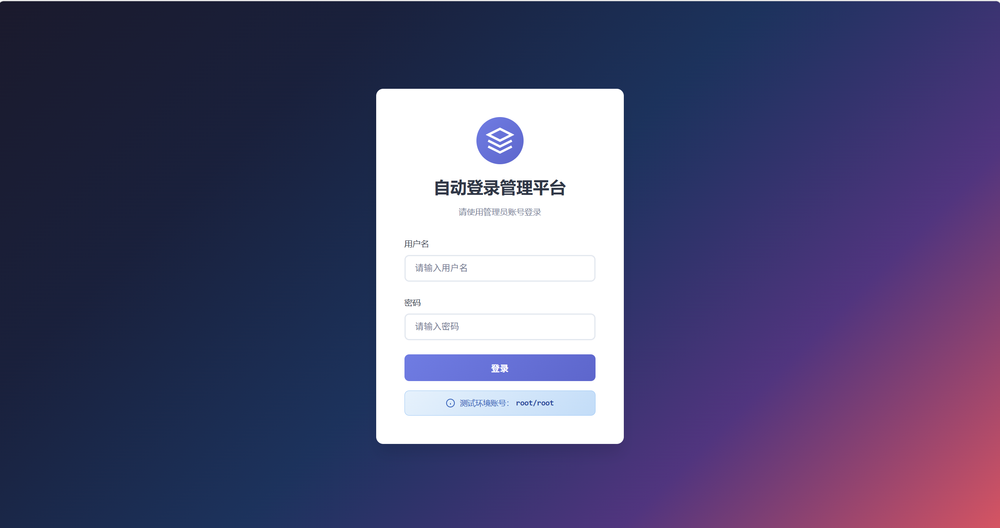

**用户管理**

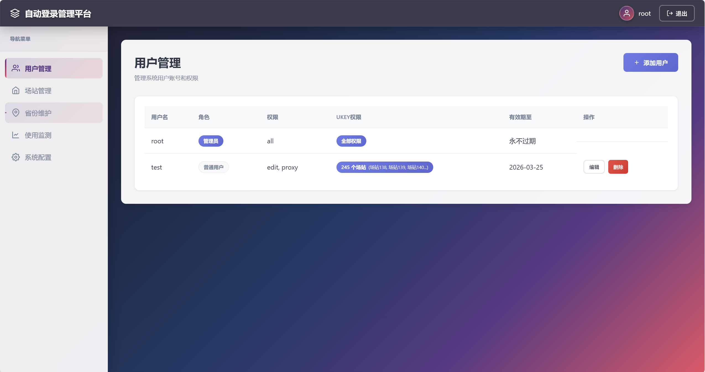

**场站管理**

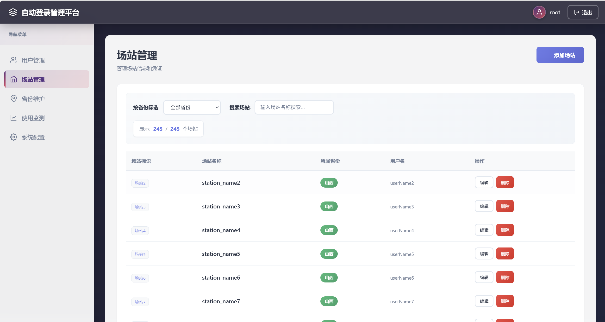

**使用监测**

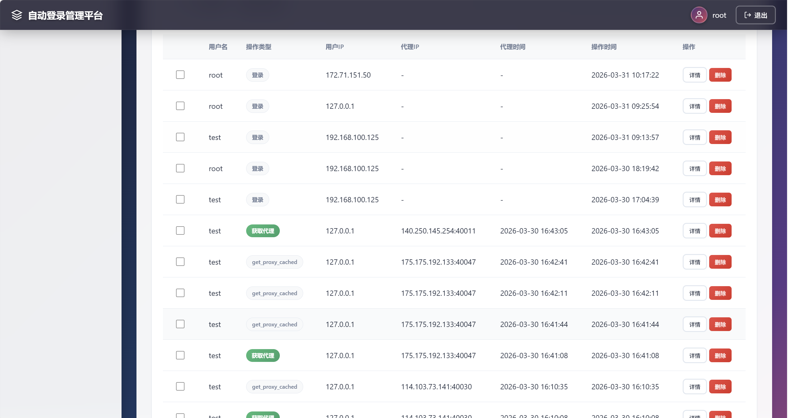

**省份维护**

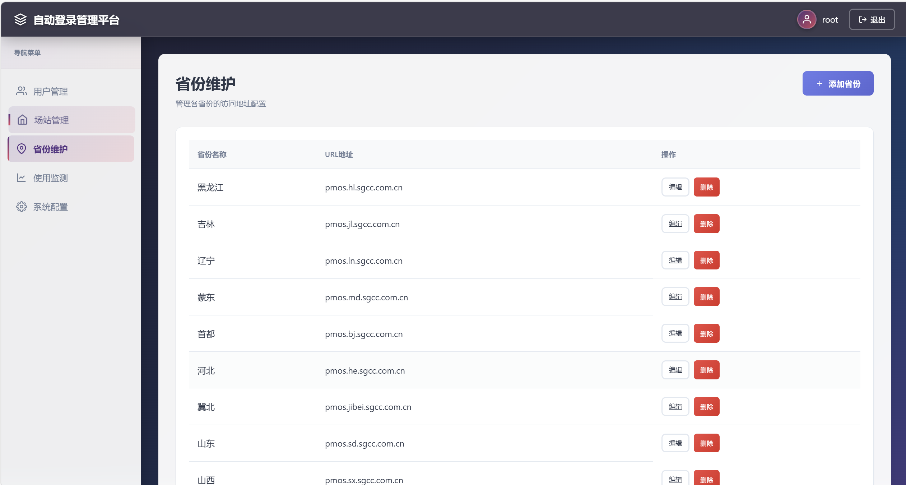

### 客户端插件

**客户端接口设置**

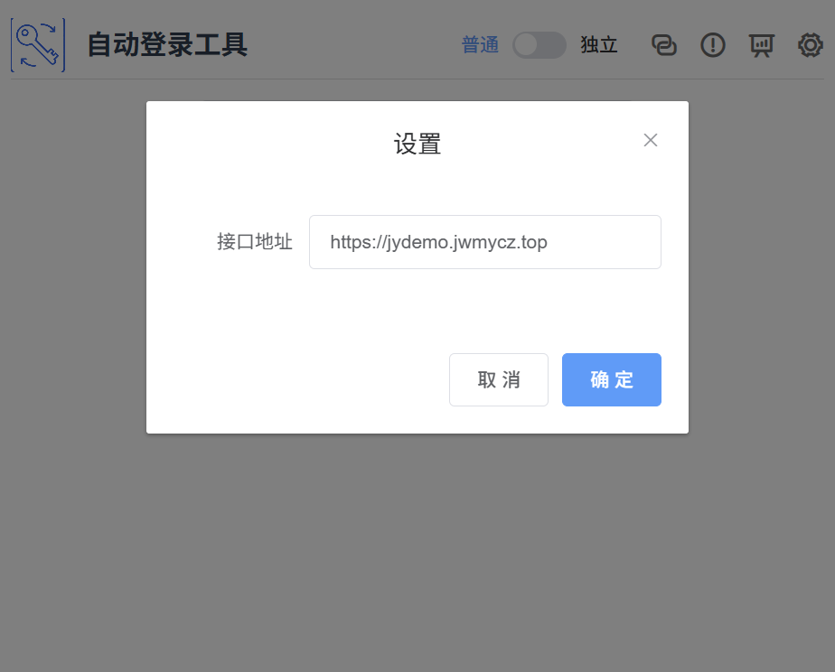

**支持魔改浏览器**

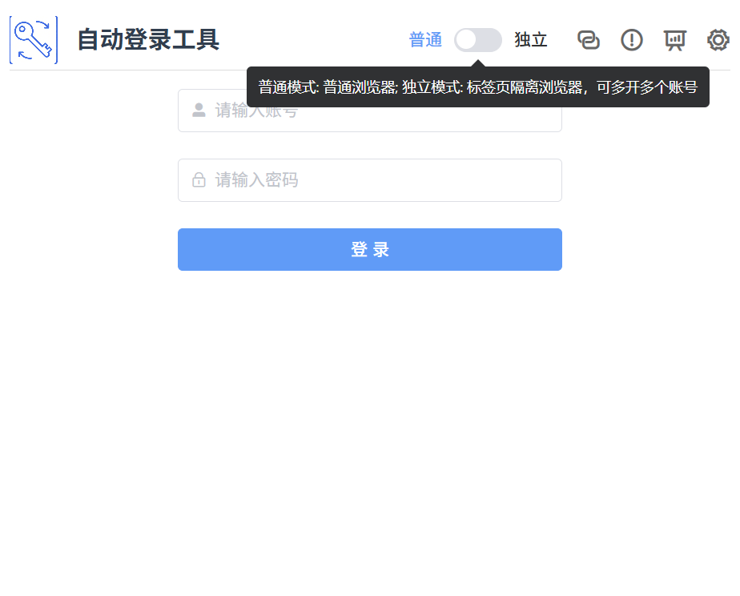

**代理设置**

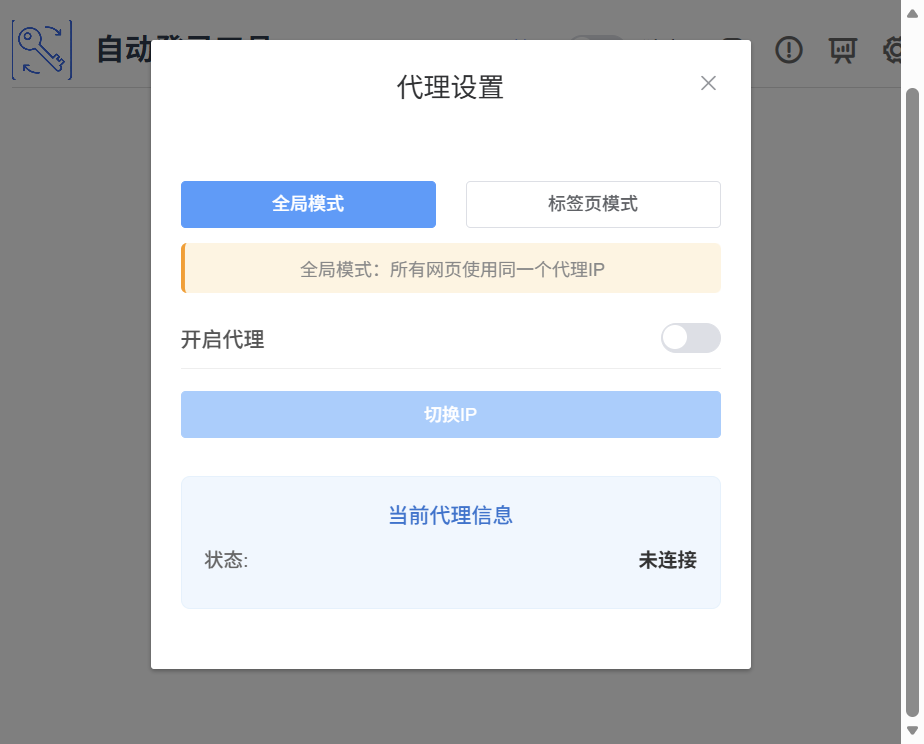

**系统监测**

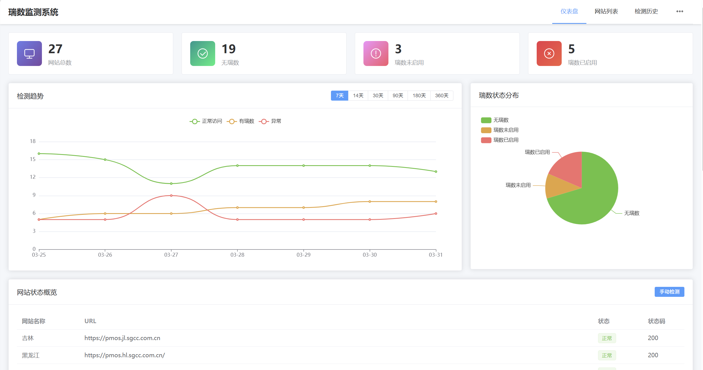

**省份选择**

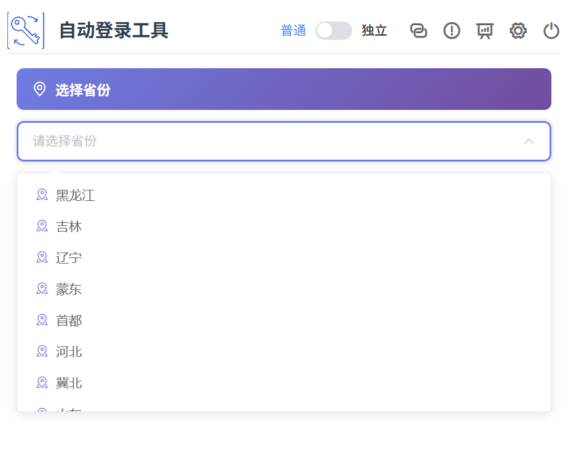

**UKey 使用**

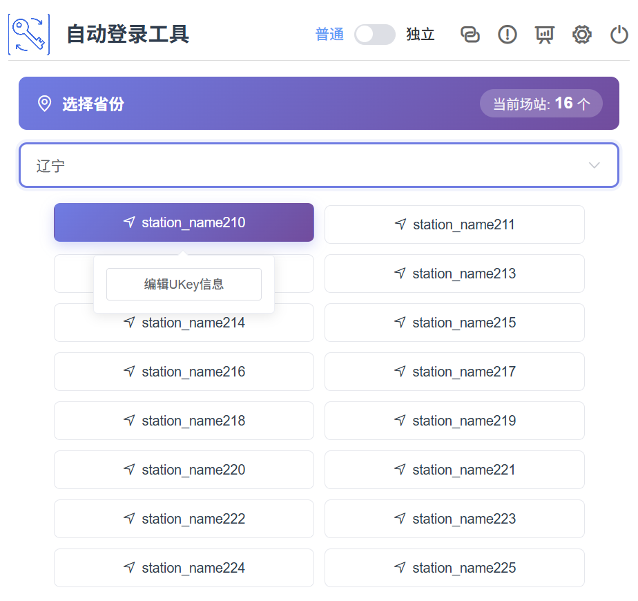

---

## 免责声明

本工具仅用于内部研究与工作效率提升，不得用于非法用途。

---

## 反馈

通过 Issue 处理问题反馈。
